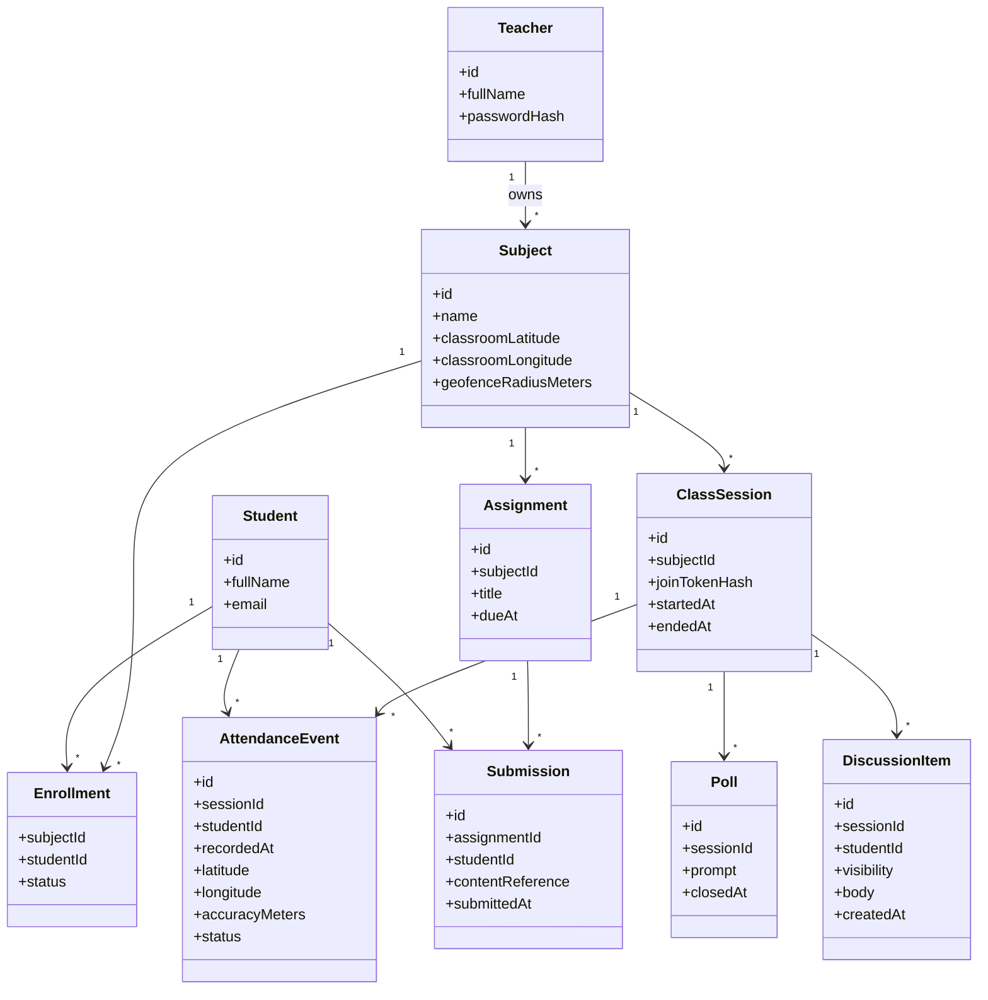

# ClassTeachWeb: Statement of Work and Software Requirements Specification

**Status:** Implementation baseline for the classroom demo  
**Deployment target:** Render Web Service with Render PostgreSQL  
**Primary users:** Managers, teachers, and students
**Source assignment:** Introduction to Software Engineering, Ex2: Vibe Coding & Deep Designing: Web-based Teaching Tool

## 1. Purpose and problem statement

ClassTeachWeb is a mobile-friendly web application for supporting an in-person class. It should make attendance simple and reviewable, give students low-friction ways to participate, and provide useful AI-assisted learning tools without requiring integrations with a learning-management system or video-conferencing service.

The assignment identifies five capabilities:

1. Simple attendance, with an online/offline spreadsheet as the most important outcome.
2. Student comments and suggestions, live or offline.
3. Quick polls created by a lecturer during class.
4. An ML-generated summary of a class recording.
5. In-depth, LLM-assisted homework review, including comparison with other submissions.

The application is a web service usable from a phone browser. It is designed to be demonstrable in a short, approximately 10-minute class demo.

## 2. Scope and delivery plan (SoW)

### 2.1 Demo / first release

The first release implements all five assignment capabilities, with attendance
as the priority for the approximately 10-minute demo:

- Teacher signs in, creates a subject/class, and enrolls students from the roster.
- Teacher starts a class session and displays its QR code.
- A student scans the code, identifies themself from the class roster, and grants location permission.
- The application automatically saves the initial check-in and each subsequent check to PostgreSQL, attempting another check every 10 minutes while the student page is open and active.
- The teacher sees saved attendance status. CSV is a convenience download, not the persistence mechanism.
- The teacher can end the session; its QR code can no longer be used to join.
- Students can submit questions/suggestions and poll votes; drafts can queue locally while offline.
- Teachers can submit text transcripts for an OpenAI summary draft and approve/edit the draft before publication.
- Teachers can create text-based assignments, request OpenAI feedback, and inspect local text-similarity indicators.

### 2.2 Later increments

- **Hardening:** operational monitoring, a confirmed retention policy, stronger student identity verification, accessibility review, and production-grade abuse controls.

### 2.3 Out of scope

- Moodle, Zoom, Google Meet, or Google Classroom integrations.
- Native iOS or Android applications.
- Automatic face recognition or photo-based identity matching in the first release.
- Automated grading, plagiarism verdicts, or disciplinary decisions.
- Collecting student government ID numbers or other unnecessary sensitive identifiers.
- Guaranteeing a student's physical presence from a MAC address or a GPS reading.
- Direct video uploads, video transcription, and document uploads; the implemented AI input is pasted transcript text and plain-text homework.

## 3. Important feasibility constraint: location and router MAC

A web page cannot read the Wi-Fi router's MAC address. The browser does not expose a student's device MAC address to the website, and a Render-hosted server receives internet requests rather than direct access to the classroom's local network. A QR code does not change this limitation. Therefore, checking a router MAC every 10 minutes is not implementable for this web-service architecture.

Some native Android apps may be able to read the connected access point's BSSID (often called its router MAC) with OS permissions and location services enabled. Access is restricted and varies by operating system and device, so a native app would not provide a reliable cross-platform solution; the Render server still could not independently verify the value sent by the app. Router-MAC checking is therefore not part of this product's attendance design.

The feasible design for the demo is:

- Use the browser Geolocation API with the student's explicit permission.
- Check the reported coordinates against a teacher-configured classroom point and radius on the server.
- Request a new check every 10 minutes while the student page is open and in the foreground. Mobile browsers may throttle or suspend background pages.
- Label location evidence as **inside**, **outside**, **stale**, or **unavailable**; do not describe it as tamper-proof. GPS can be inaccurate or spoofed.
- Evaluate coordinates on the server but do not retain raw coordinates; save only the evaluated status, reported accuracy, server timestamp, and an unavailable reason where relevant.

The classroom radius, acceptable GPS accuracy, policy for missed checks, and retention period must be confirmed before real classes. The demo defaults to a configurable 100 m radius and 100 m maximum reported accuracy; these values must be tested in the classroom and are not universal attendance policies.

## 4. Users and permissions

| Role | Capabilities |
|---|---|
| Manager | Create teacher and student accounts and subjects, assign teachers to subjects, and enroll students in subjects. Managers cannot access teacher-only class operations unless they also sign in as a teacher. |
| Teacher | Manage assigned subjects and sessions, display/revoke session QR codes, view and export attendance, manage polls and discussion, provide class material, and review AI outputs. |
| Student | Join a session for which they are rostered, submit location check-ins, participate in polls/discussion, and access permitted class summaries and their own homework feedback. |

Managers, teachers, and students use separate authentication records and protected routes. Teachers must only access their assigned classes. Students must only access classes and submissions they are entitled to see. The demo uses roster selection, clearly marked as demo-only and not strong authentication. A stronger student verification method is required before production use.

## 5. Software requirements specification (SRS)

### 5.1 Functional requirements

#### Accounts, rosters, and subjects

- **FR-01:** The system shall store manager and teacher account passwords as hashes, never plaintext passwords.
- **FR-01a:** The system shall provide separate manager and teacher authentication and shall not permit public manager self-registration.
- **FR-01b:** A manager shall be able to create teacher accounts and student roster entries in the application.
- **FR-01c:** A manager shall be able to create subjects, assign a teacher to each subject, and enroll students in subjects.
- **FR-01d:** A manager shall be able to reassign a subject to a different teacher. Reassignment shall change which teacher can manage that subject.
- **FR-02:** A teacher shall be able to manage one or more subjects/classes.
- **FR-03:** The system shall associate students with classes using a roster containing only the fields needed for class operation.
- **FR-04:** The system shall prevent a teacher from accessing another teacher's class data.
- **FR-05:** For the demo, the system shall allow a student to select an enrolled roster entry after scanning the class QR code and shall clearly disclose that this is not identity verification.

#### Attendance and QR sessions

- **FR-06:** A teacher shall be able to start and end a session for a subject.
- **FR-07:** Starting a session shall create a high-entropy, unguessable QR join link scoped to that session. Ending or replacing a session shall invalidate its previous link.
- **FR-08:** A student shall be able to scan the QR code on a smartphone browser and join the matching session.
- **FR-09:** The system shall automatically save a server-timestamped initial attendance event to PostgreSQL for an eligible student before confirming check-in. Saving shall not depend on a teacher action or CSV export.
- **FR-10:** With permission, the student's browser shall submit a location check-in every 10 minutes while the session page remains active. The interface shall display the last check time and permission/accuracy status.
- **FR-11:** The server shall classify each check-in against the session's configured classroom location and radius and automatically save the event, result, reported accuracy, and server timestamp to PostgreSQL.
- **FR-12:** The teacher shall see a roster-based attendance view with student, first check-in, last check-in, and current evidence status.
- **FR-13:** The teacher may download attendance as a CSV spreadsheet generated from the saved database records. Export is optional and shall not be the persistence mechanism.
- **FR-14:** The teacher shall be able to manually correct attendance; the correction and an audit record containing the teacher, time, and reason shall be saved to PostgreSQL.
- **FR-15:** The system shall distinguish no permission, outside radius, stale/missed check, and confirmed-within-configured-radius results. It shall not infer absence solely from a GPS failure.

#### Questions, suggestions, and polls

- **FR-16:** A student shall be able to submit a question or suggestion associated with an active subject session.
- **FR-17:** A student shall be able to mark a submission as public to the class or private to the teacher.
- **FR-18:** A teacher shall be able to view, answer, and moderate submissions. Private items shall not be exposed to other students.
- **FR-19:** A teacher shall be able to create a poll with a prompt and a bounded set of choices during a session.
- **FR-20:** A student shall be able to submit at most one vote per poll unless the teacher explicitly reopens or resets it.
- **FR-21:** A teacher shall be able to view poll results and close a poll.
- **FR-22:** Participation features shall support offline submission by saving a clearly labeled local draft and submitting it when connectivity returns. The UI shall not report a draft as delivered until the server confirms receipt.

#### Class summaries

- **FR-23:** A teacher shall be able to paste a class transcript as input to an AI summary workflow.
- **FR-24:** The system shall save the transcript, show generation status, and report a useful error if OpenAI is unavailable or summarization fails.
- **FR-25:** The system shall identify generated summaries as AI-generated and allow a teacher to review/edit them before students can see them.
- **FR-26:** The implementation shall not require direct integration with Zoom, Meet, or Classroom. It supports transcript text only; video and document uploads are out of scope.

#### Homework review

- **FR-27:** A teacher shall be able to create an assignment with instructions and a submission deadline.
- **FR-28:** A student shall be able to submit or replace their own homework before the deadline, subject to teacher policy.
- **FR-29:** The system shall provide AI-generated review and feedback to the student and teacher, clearly labeled as suggestions rather than grades.
- **FR-30:** The system shall compare submissions for notable textual similarity and show relevant excerpts only to authorized teachers. Similarity is a review signal, not a plagiarism finding.
- **FR-31:** The system shall not expose one student's full submission or feedback to another student.

### 5.2 Non-functional requirements

- **NFR-01 Usability:** Core scan-to-check-in shall be usable on a typical smartphone browser without installing an app.
- **NFR-02 Reliability:** Attendance check-ins, teacher corrections, poll votes, questions, assignment submissions, transcripts, and generated outputs shall be persisted in PostgreSQL before success is reported (except offline drafts, which are explicitly labeled as local). Saved records shall remain available after page reloads or web-service restarts. Persistence shall be automatic and independent of CSV export.
- **NFR-03 Security:** Use HTTPS in deployment, secure HTTP-only session cookies, CSRF defenses for state-changing form actions, parameterized SQL, rate limiting on authentication, and authorization checks on every protected resource.
- **NFR-04 Privacy:** Collect location only during an active session after permission; evaluate coordinates server-side but do not retain raw coordinates; disclose that check-in status and accuracy are saved. Confirm retention and deletion policy before real classes.
- **NFR-05 Accessibility:** Use semantic HTML, labels, keyboard-accessible controls, visible status messages, and color-independent status indicators.
- **NFR-06 Performance:** For a class-sized roster, attendance view and CSV export should complete within 3 seconds under normal service conditions. The target class size remains to be confirmed.
- **NFR-07 Resilience:** Show offline/failed-submission state clearly and retry only idempotent submissions or submissions carrying a deduplication key.
- **NFR-08 Hosting:** Run as a Node.js web service on Render, with PostgreSQL as persistent application storage. Secrets shall be environment variables, not committed to source control.
- **NFR-09 Observability:** Provide a health endpoint and log operational failures without logging passwords, raw session tokens, or unnecessary student location data.

## 6. Main use cases / client stories

1. **Start attendance:** As a teacher, I want to start a class session and display a subject-specific QR code so students can join quickly.
2. **Check in:** As a student, I want to scan the QR code and confirm attendance with minimal steps on my phone.
3. **Maintain attendance:** As a teacher, I want to see late, stale, unavailable, and in-radius check-ins distinctly so I can evaluate attendance fairly.
4. **Export the roster:** As a teacher, I want to download a spreadsheet of attendance so I can review it offline.
5. **Ask or suggest:** As a student, I want to send a question privately or to the class so I can participate without interrupting.
6. **Run a poll:** As a teacher, I want to create a quick poll and see responses during class.
7. **Review a class:** As a student, I want to read a teacher-approved summary of class material after the lesson.
8. **Improve homework:** As a student, I want actionable feedback on my work; as a teacher, I want to review the feedback and similarity indicators without treating them as automatic judgments.

## 7. Main software components

| Component | Responsibility |
|---|---|
| Mobile-friendly web UI | Teacher dashboard, student join/check-in, attendance, polls, questions, summaries, and submissions. |
| Express application/API | Authentication, authorization, session management, validation, feature routes, and response formatting. |
| PostgreSQL | Managers, teachers, students, subjects, teacher assignments, student memberships, class sessions, attendance events, polls, discussion, assignments, submissions, and persistent web sessions. |
| QR/session service | Creates scoped random session tokens, renders QR images, and expires/revokes links. |
| Attendance/location service | Validates check-in ownership, timestamps events, evaluates configurable geofence rules, and exports CSV. |
| OpenAI adapter | Generates transcript summaries and homework feedback after teacher confirmation; model is configurable, while text similarity is calculated locally. |
| Render deployment | Hosts the web process and managed PostgreSQL; provides TLS, environment variables, health checks, and service logs. |

AI calls use a server-side adapter so the provider can be substituted and failures can be reported without losing source text. Requests are disabled unless an OpenAI API key is configured and the teacher confirms external processing. The deployment owner must review OpenAI's privacy, retention, and data-processing terms before sending real student content.

## 8. Conceptual data model

The implementation shall define `Teacher`, `Student`, and `Subject` as three separate domain classes, not only as database tables or unstructured records. Each class represents its entity and owns its relevant validation and behavior; persistence code maps instances to and from PostgreSQL records.

- **Teacher** has many **Subjects**.
- **Subject** has many **Enrollments**, **ClassSessions**, **Polls**, **DiscussionItems**, and **Assignments**.
- **Student** participates in many subjects through **Enrollment**.
- **ClassSession** belongs to one subject and has many **AttendanceEvents**.
- **AttendanceEvent** belongs to one student and one session; stores server time, optional reported coordinates/accuracy, and evaluated status.
- **Poll** belongs to one subject/session and has many **PollOptions** and **Votes**.
- **DiscussionItem** belongs to one subject/session and has a visibility (`private_to_teacher` or `class`).
- **Assignment** belongs to one subject and has many **Submissions**; a submission belongs to one student.
- AI output is associated with its source recording/transcript or submission and stores provider/model metadata and generation status, not credentials.

Teacher and student identity records should use internal IDs. Names and email addresses are roster data; student ID numbers are not required.

## 9. Low-level class diagram (conceptual)



This is a logical design, not a final migration. Foreign keys, unique constraints (including one vote per student/poll), indexes, token hashing, and retention behavior must be specified in implementation migrations.

## 10. Key sequence: QR join and attendance check-in

```mermaid
sequenceDiagram
  actor Teacher
  actor Student
  participant Browser as Student browser
  participant App as ClassTeachWeb service
  participant DB as PostgreSQL

  Teacher->>App: Start subject session
  App->>DB: Store active session and token hash
  App-->>Teacher: Return QR code for join URL
  Student->>Browser: Scan QR code
  Browser->>App: Open join URL with session token
  App->>DB: Validate active session
  App-->>Browser: Show student identification and location-permission prompt
  Student->>Browser: Identify as rostered student; grant location permission
  Browser->>App: Submit session, student, coordinates, accuracy
  App->>DB: Validate enrollment and automatically save evaluated attendance event
  App-->>Browser: Show status and last check time
  loop Every 10 minutes while page is active
    Browser->>App: Submit a new location check-in
    App->>DB: Record event and update evaluated status
    App-->>Browser: Show latest status
  end
  Teacher->>App: View/export attendance
  App->>DB: Read roster and attendance events
  App-->>Teacher: Attendance view or CSV
```

The server must derive timestamps itself and must not trust a student-supplied status. Each check-in must be authorized against the active session and subject enrollment.

## 11. Deployment and operational notes

- Deploy the Node.js service and Render PostgreSQL using the repository's Render Blueprint.
- The Blueprint's free Render PostgreSQL database has a 1 GB limit and expires 30 days after creation. It can be upgraded during Render's 14-day grace period; after that, Render deletes the database and its data. Free databases do not include backups, so this plan is for demos and testing, not reliable retention of real class data.
- Configure `DATABASE_URL`, `SESSION_SECRET`, public service URL, and any AI-provider credentials in Render environment settings.
- Use HTTPS for geolocation and secure cookies. Browser geolocation requires a secure context and student permission.
- Configure backups, data retention, and an incident/contact process before production use.
- CSV import should be treated as an administrative/demo mechanism; do not commit real student rosters or plaintext passwords.

## 12. Testing strategy and acceptance criteria

### 12.1 Unit tests

- Geofence boundary, inaccurate/invalid coordinates, and status classification.
- Active/expired QR token validation and token uniqueness.
- Attendance export formatting, including students with no check-in.
- Poll vote uniqueness and discussion visibility rules.
- Input validation, including malformed uploads and empty/oversized submissions.

### 12.2 Integration tests

- Teacher authorization boundaries for subjects, sessions, exports, and submissions.
- Student enrollment checks and check-in persistence, including duplicate/retried requests.
- Session end/replacement invalidates old QR links.
- Attendance export matches persisted roster and check-ins.
- Poll closing, private questions, and offline draft resubmission behavior.
- AI provider success, timeout/failure, and output review/publishing states using a mock provider.

### 12.3 End-to-end and real-class demo

- On a smartphone, sign in as a teacher, select a subject, start a session, and scan its QR code as a student.
- Verify the first check-in is saved in PostgreSQL and remains visible after a page reload; optionally download the saved rows as CSV.
- Keep the student page active long enough to verify a second scheduled check-in, or use a test clock for automated tests; demonstrate a denied permission and stale status as separate outcomes.
- Test GPS permission and geofence behavior at the intended classroom in advance. Do not claim MAC-address validation.
- Run one poll and one public/private question flow if included in the demo.
- Confirm no student sees another student's private question, submission, or homework feedback.
- Verify Render health check, database persistence across web-service restart, and useful error behavior when the database or AI provider is unavailable.

### 12.4 Demo acceptance criteria

The attendance demo is acceptable when a teacher can start a subject session, a student can scan and join from a phone, each check-in is automatically saved to PostgreSQL, and the teacher can still see the saved status after reloading the page. A CSV may be downloaded from those saved records but is not required for persistence. Location outcomes and limitations must be accurately described. The demo shall use test/student-approved data.

## 13. Decisions to confirm before implementation

1. What stronger student identity verification should replace demo roster selection before real classes.
2. Classroom coordinates, radius, acceptable accuracy, and missed-check policy.
3. Attendance, question, submission, transcript, and AI-output retention/deletion periods.
4. OpenAI API key/model configuration, usage budget, and data-processing terms for the deployed service.
5. Expected class size and deployment plan beyond the temporary Render free database.
